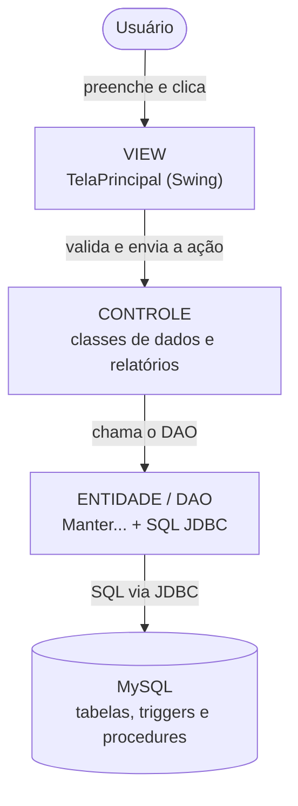
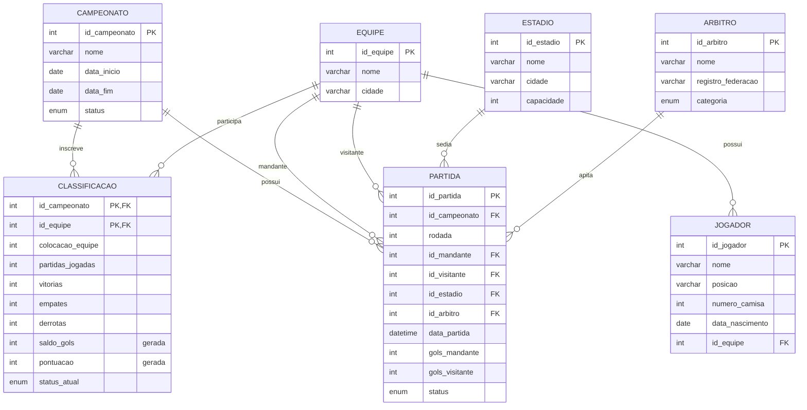
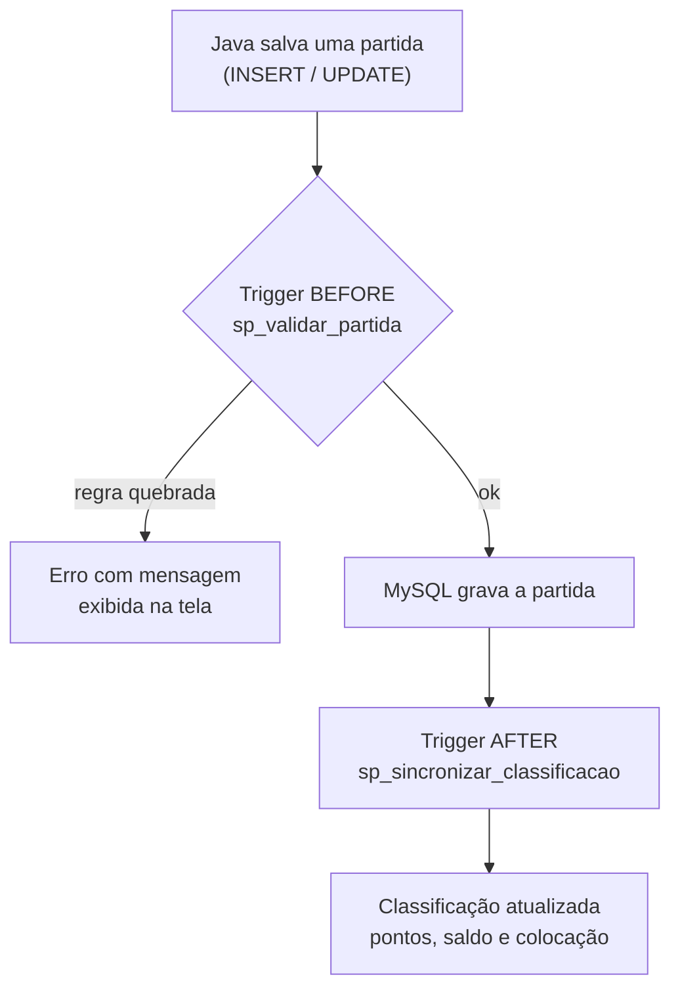

<div align="center">

# ⚽ Champs - Sistema de Gestão de Campeonatos

**Sistema desktop em Java para organizar campeonatos de futebol: cadastros, inscrição das equipes, agendamento e resultado das partidas, classificação automática e relatórios.**


Trabalho final da disciplina de **Programação Orientada a Objetos**

[Sobre](#-sobre-o-projeto) •
[Funcionalidades](#-funcionalidades) •
[Arquitetura](#-arquitetura-mvc) •
[Banco de dados](#-banco-de-dados) •
[Como executar](#-como-executar) •
[Estrutura](#-estrutura-do-repositório) •
[Documentação](#-documentação)

</div>

---

## 📌 Sobre o projeto

Organizar um campeonato exige saber **quem joga contra quem, onde, quando, com qual árbitro** e, ao fim de cada rodada, **como está a classificação**. O **Champs** centraliza essas informações num sistema desktop feito em **Java Swing**, com os dados guardados em **MySQL**.

- **Rotina principal:** o **registro de partidas**. O organizador agenda o jogo relacionando campeonato, equipes, estádio e árbitro e, depois, lança o resultado.
- **Elenco:** cada equipe pode ter seus **jogadores** cadastrados (nome, posição, camisa e nascimento).
- **Entidade central:** a **classificação**, que liga cada campeonato às equipes inscritas e é recalculada automaticamente pelos triggers do banco a cada partida incluída, alterada ou excluída.
- **Relatórios:** classificação do campeonato (relatório principal, com JOIN entre as tabelas da rotina) e partidas por período (com impressão/PDF pelo próprio Swing).

> 📋 Acompanhamento do trabalho no [Notion](https://solux.notion.site/POO-Trabalho-em-Grupo-3f83d05adda5803f9eb5f7d682b56de3).

---

## ✨ Funcionalidades

| | Funcionalidade | Descrição | Status |
|---|---|---|---|
| 🏆 | **Campeonatos** | nome, período e situação; cadastrar, consultar, alterar e excluir | ✅ |
| 👕 | **Equipes** | nome e cidade; cadastrar, consultar, alterar e excluir | ✅ |
| 🧍 | **Jogadores** *(CRUD extra)* | nome, posição, camisa, nascimento e equipe; cadastrar, consultar, alterar e excluir | ✅ |
| 🏟️ | **Estádios** | nome, cidade e capacidade; cadastrar, consultar, alterar e excluir | ✅ |
| 🧑‍⚖️ | **Árbitros** | nome, registro na federação e categoria; cadastrar, consultar, alterar e excluir | ✅ |
| 📝 | **Inscrição** | inscrever equipes em um campeonato e atualizar o status na competição | ✅ |
| ⚽ | **Partidas** *(CRUD principal)* | agendar jogo, lançar placar, alterar e excluir | ✅ |
| 📊 | **Classificação automática** | pontos, saldo de gols e colocação calculados pelo banco | ✅ |
| 🔎 | **Pesquisa individual** | cada CRUD consulta por ID, nome ou outro campo identificador | ✅ |
| 🛡️ | **Validação dos botões** | ações de escrita só funcionam com os campos obrigatórios preenchidos e válidos | ✅ |
| 🖨️ | **Relatório de classificação** | relatório principal, com JOIN entre classificação, campeonato, equipe, partida, estádio e árbitro | ✅ |
| 📅 | **Relatório de partidas por período** | partidas com nomes, placar e situação; impressão/PDF | ✅ |

### Requisitos do trabalho

| Requisito | Onde está no projeto |
|---|---|
| 4 CRUDs simples | Campeonato (aba 1), Equipe (aba 2), Estádio (aba 4) e Árbitro (aba 5) da `TelaPrincipal` |
| CRUD extra | Jogador (aba 3), relacionado a Equipe por chave estrangeira |
| 1 CRUD principal com relacionamentos | Partida (aba 7), com 5 chaves estrangeiras e regras de negócio |
| Consulta com JOIN | `sp_relatorio_classificacao` e `sp_relatorio_partidas_periodo`; listagens Java de partidas, classificação e jogadores |
| Relatório da rotina principal | Aba **8. Relatórios** → classificação do campeonato e partidas por período |
| MySQL com PK, FK e relacionamentos | [`SQL_Champs/Champs_schema.sql`](SQL_Champs/Champs_schema.sql) |
| Java + POO + Swing + JDBC + MVC | [`Java_Champs/src/br/com/`](Java_Champs/src/br/com) |
| Pesquisa individual | métodos `pesquisarRegistro(...)` de cada classe `Manter...` |
| Validação de campos | `vincularValidacao(...)` e validações dos eventos da tela |

---

## 🛠️ Tecnologias

| Camada | Tecnologia |
|---|---|
| Linguagem | Java (JDK 26, configurado no projeto NetBeans) |
| Interface | Java Swing (`JFrame`, `JTabbedPane`, `JTable`, `JComboBox`) |
| Banco de dados | MySQL 8 (mínimo 8.0.16) |
| Acesso a dados | JDBC + MySQL Connector/J 9.3.0 |
| IDE / build | Apache NetBeans (Ant) |
| Testes do banco | SQL e, opcionalmente, Docker (`mysql:8.4`) |

---

## 🧱 Arquitetura MVC

O sistema segue o padrão **Model-View-Controller**: cada camada tem uma responsabilidade e a lógica **não** fica concentrada nos eventos dos botões.



A resposta faz o caminho inverso: o banco devolve as linhas (ou um erro), o DAO monta os objetos, a tela exibe os dados ou a mensagem para o usuário.

| Camada | Pacote | Responsabilidade |
|---|---|---|
| **Model** | `br.com.controle` | classes de dados (`Campeonato`, `Equipe`, `Jogador`, `Partida`, `Classificacao`, `RelatorioClassificacao`…) com atributos privados e get/set |
| **DAO / Entidade** | `br.com.entidade` | conexão (`DAO`) e SQL de cada entidade (`ManterCampeonato`, `ManterEquipe`, `ManterJogador`, `ManterEstadio`, `ManterArbitro`, `ManterClassificacao`, `ManterPartida`, `ManterRelatorio`) com `PreparedStatement` |
| **View** | `br.com.visao` | tela Swing principal; exibe dados, valida campos e repassa ações |

> As telas `Cadastro`, `Alterar`, `Deletar` e `Listar` são formulários antigos do NetBeans, mantidos apenas como rascunho e **não são usados** pelo sistema. A tela usada é a **`TelaPrincipal`**, construída diretamente em código Java (o `.form` dela foi removido para o NetBeans abrir o arquivo como fonte, sem tentar carregar um editor visual incompatível).

### Pesquisa individual

Cada classe `Manter...` tem um método `pesquisarRegistro(...)` que recebe o texto digitado no campo **Pesquisar** e devolve **um objeto** (ou `null`). O botão **Consultar** chama esse método e preenche o formulário:

```java
// Exemplo do ManterArbitro
public Arbitro pesquisarRegistro(String termo) throws Exception {
    // aceita id, parte do nome ou registro na federação
    String query = "SELECT id_arbitro, nome, registro_federacao, categoria FROM ARBITRO "
            + "WHERE id_arbitro = ? OR nome LIKE ? OR registro_federacao LIKE ? "
            + "ORDER BY (id_arbitro = ?) DESC, nome LIMIT 1";
    // ...
}
```

Na tela, a busca é ligada ao botão:

```java
btnConsultar.addActionListener(e -> {
    Arbitro a = daoArbitro.pesquisarRegistro(txtBuscaArbitro.getText().trim());
    if (a != null) {
        // a tela copia para os campos os atributos que retornaram do banco
        txtIdArbitro.setText(String.valueOf(a.getIdArbitro()));
        txtNomeArbitro.setText(a.getNome());
        txtRegArbitro.setText(a.getRegistro_federacao());
        cbCatArbitro.setSelectedItem(a.getCategoria());
    } else {
        JOptionPane.showMessageDialog(this, "Nenhum árbitro encontrado!");
    }
});
```

### Validações dos botões

- **Cadastrar / Alterar / Excluir** ficam desabilitados enquanto os campos obrigatórios estiverem vazios ou inválidos.
- **Consultar** só habilita quando há um termo de pesquisa digitado.
- **Datas** precisam estar em `YYYY-MM-DD`, e a data final não pode ser anterior à inicial.
- **Capacidade do estádio** deve ser um número maior que zero.
- **Partida:** rodada > 0, data/hora válida, acréscimo e gols não negativos, mandante diferente do visitante, combos de campeonato/equipes/estádio/árbitro preenchidos e placar coerente com o status.
- **Alterar / Excluir / status de inscrição** exigem um registro selecionado ou consultado.
- **Exclusões** pedem confirmação.
- Mesmo com a validação da tela, o **banco é a última barreira**: triggers recusam data fora do campeonato, equipe não inscrita, equipe duas vezes na rodada e árbitro/estádio ocupado.

---

## 🗄️ Banco de dados

### Modelo de dados



- **`CLASSIFICACAO`** resolve a relação **N:N** entre campeonato e equipe (inscrição) e guarda os números de cada equipe.
- **`PARTIDA`** é a rotina principal: liga campeonato, **duas equipes** (mandante e visitante), estádio e árbitro.
- `saldo_gols` e `pontuacao` são **colunas geradas**: o MySQL calcula sozinho.

### Regras de negócio garantidas pelo banco

Ao salvar uma partida, o banco recusa (com mensagem em português):

| Regra | Mensagem |
|---|---|
| Data fora do período do campeonato | `Data da partida fora do periodo do campeonato` |
| Equipe não inscrita no campeonato | `Equipe nao inscrita neste campeonato` |
| Equipe jogando duas vezes na mesma rodada | `Equipe ja possui partida nesta rodada` |
| Árbitro ou estádio em dois jogos no mesmo horário | `Arbitro ou estadio ja ocupado neste horario` |
| Desinscrever equipe que já jogou | `Equipe possui partidas neste campeonato` |

Além disso, regras `CHECK` impedem, por exemplo, um time jogar contra ele mesmo ou um jogo encerrado sem placar. Partidas **canceladas** não ocupam rodada, árbitro nem estádio.

Na tabela **`JOGADOR`**, o `UNIQUE (id_equipe, numero_camisa)` impede dois jogadores com a mesma camisa na mesma equipe, e o `CHECK` exige camisa entre 1 e 99. A FK para `EQUIPE` garante que o jogador pertence a uma equipe cadastrada.

### Classificação automática

**Vitória = 3 pontos · Empate = 1 · Derrota = 0**
Desempate: pontos → vitórias → saldo de gols → gols marcados.



### Scripts

| Arquivo | Conteúdo |
|---|---|
| [`Champs_schema.sql`](SQL_Champs/Champs_schema.sql) | cria o banco `campeonato`: tabelas, PK, FK, `CHECK`, `UNIQUE` |
| [`Champs_procedures_triggers.sql`](SQL_Champs/Champs_procedures_triggers.sql) | validação das partidas, inscrição e classificação automática |
| [`Champs_relatorios.sql`](SQL_Champs/Champs_relatorios.sql) | procedures dos relatórios: classificação e partidas por período |
| [`99_testes.sql`](SQL_Champs/99_testes.sql) | roteiro de testes (dados de teste + verificações `OK`/`FALHOU`) |
| [`testar.sh`](SQL_Champs/testar.sh) | executa tudo num MySQL descartável via Docker |

### Relatório principal

O relatório principal parte da **classificação**, que é a entidade que conecta campeonato, equipe e partidas. A procedure junta:

- `CLASSIFICACAO` → números de cada equipe no campeonato;
- `CAMPEONATO` → nome do campeonato;
- `EQUIPE` → nome e cidade;
- `PARTIDA` → jogos em casa/fora e aproveitamento;
- `ESTADIO` e `ARBITRO` → estádios e árbitros que a equipe encontrou.

```sql
CALL sp_relatorio_classificacao(1);
```

| campeonato | posicao | equipe | cidade | pontos | jogos | V | E | D | GP | GC | SG | aproveitamento | casa | fora | estadios | arbitros |
|---|---|---|---|---|---|---|---|---|---|---|---|---|---|---|---|---|
| Copa Regional 2026 | 1 | Tigres FC | Sao Paulo | 6 | 2 | 2 | 0 | 0 | 5 | 3 | 2 | 100.0 | 1 | 1 | 2 | 2 |

*(exemplo com os dados de teste)*

O segundo relatório continua disponível:

```sql
CALL sp_relatorio_partidas_periodo(1, '2026-09-01', '2026-09-30');
```

| rodada | data_hora | mandante | visitante | estadio | arbitro | placar | status |
|---|---|---|---|---|---|---|---|
| 1 | 05/09/2026 16:00 | Tigres FC | Aguas EC | Arena Central | Carlos Andrade | 2 x 1 | ENCERRADA |
| 1 | 05/09/2026 18:30 | Leoes do Norte | Falcoes United | Estadio do Vale | Marina Souza | 0 x 0 | ENCERRADA |

Na tela, o botão **Imprimir / Salvar em PDF** usa `JTable.print()`; a janela de impressão do sistema permite salvar o relatório em PDF.

---

## 🚀 Como executar

### Pré-requisitos

- [MySQL 8](https://dev.mysql.com/downloads/mysql/) e MySQL Workbench
- JDK + [Apache NetBeans](https://netbeans.apache.org/)
- [MySQL Connector/J 9.3.0](https://dev.mysql.com/downloads/connector/j/)
- *(opcional)* [Docker](https://www.docker.com/) para rodar os testes automáticos

### 1. Criar o banco

No MySQL Workbench, abra e execute **nesta ordem**:

```
SQL_Champs/Champs_schema.sql
SQL_Champs/Champs_procedures_triggers.sql
SQL_Champs/Champs_relatorios.sql
```

> ⚠️ O `Champs_schema.sql` **apaga e recria** o banco `campeonato`. Os dados do sistema são cadastrados pelas telas.

### 2. Testar o banco *(opcional)*

Com Docker:

```bash
bash SQL_Champs/testar.sh
```

Sem Docker, execute os três scripts e depois o `99_testes.sql` no Workbench, num banco recém-criado. Todos os testes devem mostrar `OK`, e só os comandos marcados com `ESPERADO ERRO` podem falhar.

### 3. Executar a aplicação

1. Abra a pasta [`Java_Champs`](Java_Champs) no NetBeans.
2. Adicione o `mysql-connector-j-9.3.0.jar` em **Libraries** (o projeto referencia o jar que já está em `POO/mysql-connector-j-9.3.0.jar` no ambiente original; em outra máquina, aponte para o seu).
3. Confira os dados de conexão em [`DAO.java`](Java_Champs/src/br/com/entidade/DAO.java): padrão `localhost:3306`, banco `campeonato`, usuário `root`, senha vazia.
4. Execute o projeto (**F6**). A classe principal é `br.com.visao.TelaPrincipal`.

Para compilar e executar pela linha de comando:

```powershell
javac -encoding UTF-8 -d build/classes -cp "caminho/para/mysql-connector-j-9.3.0.jar" (Get-ChildItem src -Recurse -Filter *.java).FullName
java -cp "build/classes;caminho/para/mysql-connector-j-9.3.0.jar" br.com.visao.TelaPrincipal
```

---

## 📁 Estrutura do repositório

```
POO-Trabalho-Final/
├── 📂 SQL_Champs/                     # banco de dados MySQL
│   ├── Champs_schema.sql               # estrutura: tabelas, chaves, regras
│   ├── Champs_procedures_triggers.sql  # validações e classificação automática
│   ├── Champs_relatorios.sql           # procedures dos relatórios
│   ├── 99_testes.sql                   # roteiro de testes
│   └── testar.sh                       # testes automáticos (Docker)
├── 📂 Java_Champs/                     # aplicação Java (NetBeans)
│   ├── src/br/com/
│   │   ├── controle/                   # Model: entidades e classes de relatório
│   │   ├── entidade/                   # DAO: conexão e classes Manter...
│   │   └── visao/                      # View: TelaPrincipal (Swing)
│   └── nbproject/                      # configuração do projeto NetBeans
└── 📂 docs/guia/                       # guias de estudo e apresentação
```

---

## 🗺️ Roadmap

- [X] **Fase 1 (Banco de dados):** estrutura, regras da partida, classificação automática, relatório com JOIN e testes
- [X] **Fase 2 (Base Java):** pacotes MVC e conexão JDBC
- [X] **Fase 3 (Model completo):** entidades com atributos privados, get/set e `toString()`
- [X] **Fase 4 (CRUDs simples):** Campeonato, Equipe, Estádio e Árbitro
- [X] **CRUD extra (Jogador):** nome, posição, camisa, nascimento e vínculo com a equipe
- [X] **Fase 5 (CRUD principal):** Partidas, inscrição e classificação
- [X] **Fase 6 (Relatórios e demonstração):** classificação, partidas por período, impressão/PDF e validações finais

---

## 📚 Documentação

| Documento | Conteúdo |
|---|---|
| [Guia de apresentação](docs/guia/00-guia-de-apresentacao.md) | visão geral, requisitos, MVC, roteiro da demonstração e banco de perguntas |
| [Guia do banco de dados](docs/guia/01-banco-de-dados.md) | tabelas, chaves, triggers, procedures, JOIN e perguntas com respostas |
| [Guia do Java e dos relatórios](docs/guia/02-java-e-relatorios.md) | pacotes, DAOs, pesquisas individuais, validações dos botões, procedures e impressão |

---

## 👥 Equipe

| Nome | GitHub |
|---|---|
| Matheus Souza Silva | [Matheus-Souza-Silva](https://github.com/Matheus-Souza-Silva) |
| Macio Alves | [macioalves](https://github.com/macioalves) |
| Pedro de Araujo Freitas | [Pedr0-4raujo](https://github.com/Pedr0-4raujo) |
| Karl Emmanuel Diengu Mihindu | [kArldebug](https://github.com/kArldebug) |

---

<div align="center">

Projeto acadêmico desenvolvido para a disciplina de **Programação Orientada a Objetos**.

</div>
