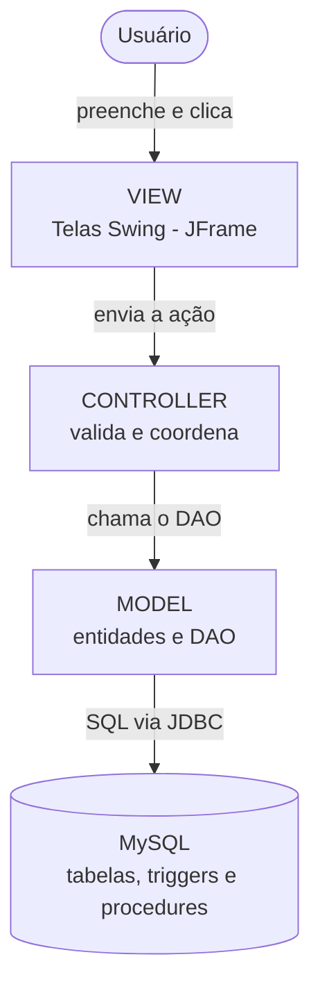
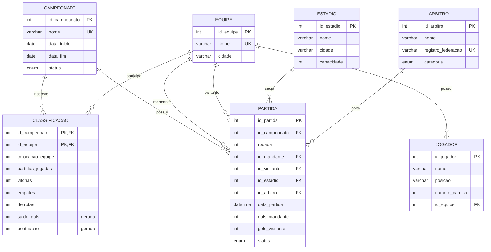
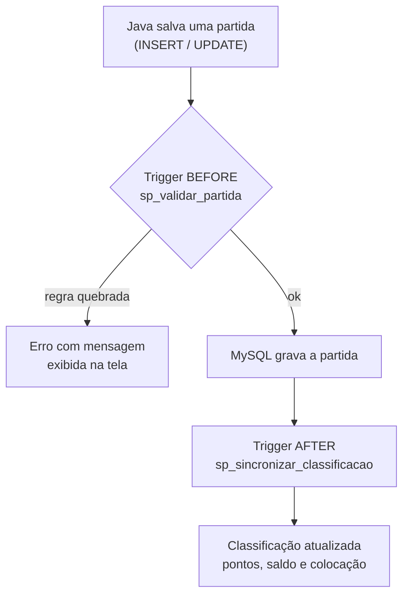

<div align="center">

# ⚽ Champs - Sistema de Gestão de Campeonatos

**Sistema desktop em Java para organizar campeonatos de futebol: cadastros, agendamento e resultado das partidas, classificação automática e relatórios.**


Trabalho final da disciplina de **Programação Orientada a Objetos**

[Sobre](#-sobre-o-projeto) •
[Funcionalidades](#-funcionalidades) •
[Arquitetura](#-arquitetura-mvc) •
[Banco de dados](#-banco-de-dados) •
[Como executar](#-como-executar) •
[Roadmap](#-roadmap) •
[Documentação](#-documentação)

</div>

---

## 📌 Sobre o projeto

Organizar um campeonato exige saber **quem joga contra quem, onde, quando, com qual árbitro** e, ao fim de cada rodada, **como está a classificação**. O **Champs** centraliza essas informações num sistema desktop feito em **Java Swing**, com os dados guardados em **MySQL**.

A **rotina principal** do sistema é o **registro de partidas**: o organizador agenda o jogo relacionando campeonato, equipes, estádio e árbitro, depois lança o resultado. A **classificação é recalculada automaticamente** pelo banco de dados a cada alteração.

> 📋 Acompanhamento do trabalho no [Notion](https://solux.notion.site/POO-Trabalho-em-Grupo-3f83d05adda5803f9eb5f7d682b56de3).

---

## ✨ Funcionalidades

| | Funcionalidade | Descrição | Status |
|---|---|---|---|
| 🏆 | **Campeonatos** | nome, período e situação | 🟢 banco · 🟡 tela |
| 👕 | **Equipes** | nome e cidade | 🟢 banco · 🟡 tela |
| 🏟️ | **Estádios** | nome, cidade e capacidade | 🟢 banco · 🟡 tela |
| 🧑‍⚖️ | **Árbitros** | nome, registro na federação e categoria | 🟢 banco · 🟡 tela |
| 📝 | **Inscrição** | inscrever equipes em um campeonato | 🟢 banco · 🟡 tela |
| ⚽ | **Partidas** *(rotina principal)* | agendar jogo, lançar placar, cancelar | 🟢 banco · 🟡 tela |
| 📊 | **Classificação automática** | pontos, saldo de gols e colocação calculados pelo banco | 🟢 banco · 🟡 tela |
| 🖨️ | **Relatório de partidas por período** | com nomes, placar e situação; impressão/PDF | 🟢 banco · 🟡 tela |

🟢 pronto · 🟡 em desenvolvimento

### Requisitos do trabalho

| Requisito | Onde está no projeto |
|---|---|
| 4 CRUDs simples | Campeonato, Equipe, Estádio, Árbitro |
| 1 CRUD principal com relacionamentos | Partida, com 5 chaves estrangeiras e regras de negócio |
| Consulta com JOIN | `sp_relatorio_partidas_periodo` e listagens Java de partidas/classificação |
| Relatório da rotina principal | Partidas por período |
| MySQL com PK, FK e relacionamentos | [`sql/Champs_schema.sql`](sql/Champs_schema.sql) |
| Java + POO + Swing + JDBC + MVC | [`Projeto Final - Campeonato/`](Projeto%20Final%20-%20Campeonato) |

---

## 🛠️ Tecnologias

| Camada | Tecnologia |
|---|---|
| Linguagem | Java (JDK 26, configurado no projeto NetBeans) |
| Interface | Java Swing (`JFrame`, `JTable`, `JComboBox`) |
| Banco de dados | MySQL 8 (mínimo 8.0.16) |
| Acesso a dados | JDBC + MySQL Connector/J 9.3.0 |
| IDE / build | Apache NetBeans (Ant) |
| Testes do banco | SQL + Docker (`mysql:8.4`) |

---

## 🧱 Arquitetura MVC

O sistema segue o padrão **Model-View-Controller**: cada camada tem uma responsabilidade, e a lógica **não** fica dentro dos eventos dos botões.



A resposta faz o caminho inverso: o banco devolve as linhas (ou um erro), o DAO monta os objetos, o Controller trata o resultado e a View exibe os dados ou a mensagem para o usuário.

| Camada | Pacote | Responsabilidade |
|---|---|---|
| **Model** | `br.com.modelo` | classes de dados (`Campeonato`, `Equipe`, `Partida`…) com atributos privados e get/set |
| **Model (DAO)** | `br.com.modelo.dao` | conexão (`ConexaoBD`) e SQL de cada entidade com `PreparedStatement` |
| **Controller** | `br.com.controle` | recebe o pedido da tela, valida, chama o DAO e trata erros |
| **View** | `br.com.visao` | telas Swing; só exibem dados e repassam ações ao Controller |

---

## 🗄️ Banco de dados

### Modelo de dados



- **`CLASSIFICACAO`** resolve a relação **N:N** entre campeonato e equipe (inscrição) e guarda os números de cada equipe.
- **`PARTIDA`** é a rotina principal: liga campeonato, **duas equipes** (mandante e visitante), estádio e árbitro.
- `saldo_gols` e `pontuacao` são **colunas geradas**: o MySQL calcula sozinho.

### Regras de negócio garantidas pelo banco

Ao salvar uma partida, o banco recusa (com mensagem em português):

| Regra | Mensagem |
|---|---|
| Data fora do período do campeonato | `Data da partida fora do periodo do campeonato` |
| Equipe não inscrita no campeonato | `Equipe nao inscrita neste campeonato` |
| Equipe jogando duas vezes na mesma rodada | `Equipe ja possui partida nesta rodada` |
| Árbitro ou estádio em dois jogos no mesmo horário | `Arbitro ou estadio ja ocupado neste horario` |
| Desinscrever equipe que já jogou | `Equipe possui partidas neste campeonato` |

Além disso, regras `CHECK` impedem, por exemplo, um time jogar contra ele mesmo ou um jogo encerrado sem placar. Partidas **canceladas** não ocupam rodada, árbitro nem estádio.

### Classificação automática

**Vitória = 3 pontos · Empate = 1 · Derrota = 0**
Desempate: pontos → vitórias → saldo de gols → gols marcados.



### Scripts

| Arquivo | Conteúdo |
|---|---|
| [`Champs_schema.sql`](sql/Champs_schema.sql) | cria o banco `campeonato`: tabelas, PK, FK, `CHECK`, `UNIQUE` |
| [`Champs_procedures_triggers.sql`](sql/Champs_procedures_triggers.sql) | validação das partidas, inscrição e classificação automática |
| [`Champs_relatorios.sql`](sql/Champs_relatorios.sql) | relatório principal com `INNER JOIN` |
| [`99_testes.sql`](sql/99_testes.sql) | roteiro de testes (dados de teste + verificações `OK`/`FALHOU`) |
| [`testar.sh`](sql/testar.sh) | executa tudo num MySQL descartável via Docker |

### Relatório principal

```sql
CALL sp_relatorio_partidas_periodo(1, '2026-09-01', '2026-09-30');
```

| rodada | data_hora | mandante | visitante | estadio | arbitro | placar | status |
|---|---|---|---|---|---|---|---|
| 1 | 05/09/2026 16:00 | Tigres FC | Aguas EC | Arena Central | Carlos Andrade | 2 x 1 | ENCERRADA |
| 1 | 05/09/2026 18:30 | Leoes do Norte | Falcoes United | Estadio do Vale | Marina Souza | 0 x 0 | ENCERRADA |

*(exemplo com os dados de teste)*

---

## 🚀 Como executar

### Pré-requisitos

- [MySQL 8](https://dev.mysql.com/downloads/mysql/) e MySQL Workbench
- JDK + [Apache NetBeans](https://netbeans.apache.org/)
- [MySQL Connector/J 9.3.0](https://dev.mysql.com/downloads/connector/j/)
- *(opcional)* [Docker](https://www.docker.com/) para rodar os testes automáticos

### 1. Criar o banco

No MySQL Workbench, abra e execute **nesta ordem**:

```
sql/Champs_schema.sql
sql/Champs_procedures_triggers.sql
sql/Champs_relatorios.sql
```

> ⚠️ O `Champs_schema.sql` **apaga e recria** o banco `campeonato`. Os dados do sistema são cadastrados pelas telas.

### 2. Testar o banco *(opcional)*

```bash
bash sql/testar.sh
```

Cria um MySQL temporário no Docker, instala os scripts, executa o `99_testes.sql` e termina com:

```
TODOS OS TESTES PASSARAM
```

Sem Docker: num banco recém-criado, execute `sql/99_testes.sql` no Workbench. Todos os testes devem mostrar `OK`, e só os comandos marcados com `ESPERADO ERRO` podem falhar.

### 3. Executar a aplicação

1. Abra a pasta `Projeto Final - Campeonato` no NetBeans.
2. Adicione o `mysql-connector-j-9.3.0.jar` em **Libraries**.
3. Confira os dados de conexão (padrão: `localhost:3306`, banco `campeonato`, usuário `root`).
4. Execute o projeto (**F6**).

> 🚧 As telas estão em desenvolvimento. Veja o [roadmap](#-roadmap).

---

## 📁 Estrutura do repositório

```
POO-Trabalho-Final/
├── 📂 sql/                          # banco de dados MySQL
│   ├── Champs_schema.sql               # estrutura: tabelas, chaves, regras
│   ├── Champs_procedures_triggers.sql  # validações e classificação automática
│   ├── Champs_relatorios.sql           # relatório com INNER JOIN
│   ├── 99_testes.sql                   # roteiro de testes
│   └── testar.sh                       # testes automáticos (Docker)
├── 📂 Projeto Final - Campeonato/   # aplicação Java (NetBeans)
│   └── src/br/com/                  # estrutura MVC (em construção na Fase 2)
│       ├── modelo/                     # Model: entidades e DAO
│       ├── controle/                   # Controller
│       └── visao/                      # View: telas Swing
└── 📂 docs/
    └── guia/                        # guias de estudo e apresentação
```

---

## 🗺️ Roadmap

- [X] **Fase 1 (Banco de dados):** estrutura, regras da partida, classificação automática, relatório com JOIN e testes
- [X] **Fase 2 (Base Java):** pacotes MVC e conexão JDBC
- [ ] **Fase 3 (Model Completo):** Converter os atributos das entidades para as classes do controle
- [X] **Fase 4 (CRUDs simples):** Campeonato, Equipe, Estádio e Árbitro
- [X] **Fase 5 (CRUD principal):** Partidas, inscrição e classificação
- [ ] **Fase 6 (Relatório e demonstração):** tela de relatório com impressão/PDF

---

## 📚 Documentação

| Documento | Conteúdo |
|---|---|
| [Guia de apresentação](docs/guia/00-guia-de-apresentacao.md) | visão geral, requisitos, MVC, roteiro da demonstração e banco de perguntas |
| [Guia do banco de dados](docs/guia/01-banco-de-dados.md) | tabelas, chaves, triggers, procedures, JOIN e perguntas com respostas |

---

## 👥 Equipe

| Nome | GitHub |
|---|---|
| Matheus Souza Silva | [Matheus-Souza-Silva](https://github.com/Matheus-Souza-Silva) |
| Macio Alves | [macioalves](https://github.com/macioalves) |
| Pedro de Araujo Freitas | [Pedr0-4raujo](https://github.com/Pedr0-4raujo) |
| Karl Emmanuel Diengu Mihindu | [ https://github.com/kArldebug) |
---

<div align="center">

Projeto acadêmico desenvolvido para a disciplina de **Programação Orientada a Objetos**.

</div>
